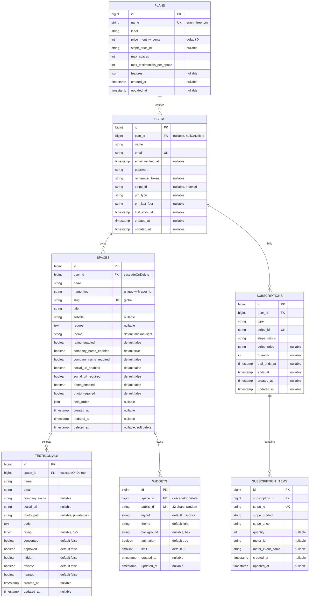
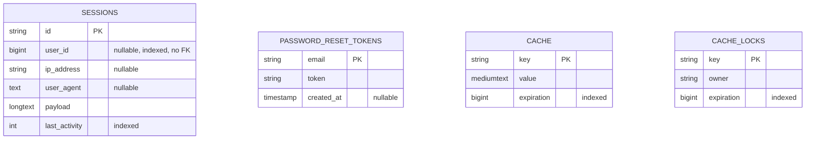

# Kudosly — Database and Data Model

This document describes the database schema of Kudosly, a testimonial collection SaaS. Every table, column, index, foreign key and relationship below was verified against the migrations in `database/migrations/` and the models in `app/Models/`.

Where a detail could not be confirmed from the source, it is marked **Unverified** rather than guessed.

---

## Table of contents

1. [Overview](#1-overview)
2. [Entity inventory](#2-entity-inventory)
3. [Entity details](#3-entity-details)
4. [Relationships](#4-relationships)
5. [ER diagram](#5-er-diagram)
6. [Enums and special structures](#6-enums-and-special-structures)
7. [Billing data](#7-billing-data)
8. [Deletion behaviour](#8-deletion-behaviour)
9. [Important constraints](#9-important-constraints)
10. [Source references](#10-source-references)

---

## 1. Overview

The database holds the state of a testimonial collection product:

- An **account** (`users`) owns a **plan** (`plans`) that sets its limits.
- An account owns **spaces** (`spaces`) — the branded public collection pages.
- A space collects **testimonials** (`testimonials`) from anonymous visitors, and owns **widgets** (`widgets`) that are embedded on other websites.
- **Billing** state is kept by Laravel Cashier in `subscriptions` and `subscription_items`, linked to the account through `users.stripe_id`.

Two design decisions shape the whole schema:

**Ownership always runs through the space.** `testimonials` and `widgets` carry only a `space_id`, never a `user_id`. A testimonial belongs to a space, and the space belongs to the account. Ownership queries therefore go through the space (`Testimonial::scopeOwnedBy()`, `Widget::scopeOwnedBy()`), and because `spaces` uses soft deletes, the rows of a deleted space are excluded automatically.

**Public identity is separate from the primary key.** A space is addressed publicly by its `slug`, and a widget by its `public_id` — a 32-character random string, not the auto-incrementing id. A widget therefore cannot be found by counting up from one, and one account's widget cannot be enumerated from another's.

### Database engines

SQLite for local development and for the test suite; MySQL is supported for production. The application writes SQL that both engines understand, so the same queries run in the tests and in production.

---

## 2. Entity inventory

### Application entities (own models)

| Entity | Table | Model file | Migration |
|---|---|---|---|
| Account | `users` | `app/Models/User.php` | `0001_01_01_000000_create_users_table.php`, `2026_11_18_000002_add_plan_id_to_users_table.php`, `2026_11_22_183846_create_customer_columns.php` |
| Plan | `plans` | `app/Models/Plan.php` | `2026_11_18_000001_create_plans_table.php` |
| Space | `spaces` | `app/Models/Space.php` | `2026_11_18_000003_create_spaces_table.php`, `2026_11_18_000004_add_field_configuration_to_spaces_table.php` |
| Testimonial | `testimonials` | `app/Models/Testimonial.php` | `2026_11_20_000005_create_testimonials_table.php` |
| Widget | `widgets` | `app/Models/Widget.php` | `2026_11_22_000006_create_widgets_table.php` |

### Framework tables (no application model)

| Table | Purpose | Migration |
|---|---|---|
| `sessions` | Database-backed session store (`SESSION_DRIVER=database`) | `0001_01_01_000000_create_users_table.php` |
| `password_reset_tokens` | Password reset tokens | `0001_01_01_000000_create_users_table.php` |
| `cache` | Application cache (`CACHE_STORE=database`) | `0001_01_01_000001_create_cache_table.php` |
| `cache_locks` | Cache lock rows; used by the submission lock | `0001_01_01_000001_create_cache_table.php` |
| `jobs` | Queue jobs | `0001_01_01_000002_create_jobs_table.php` |
| `job_batches` | Queue batches | `0001_01_01_000002_create_jobs_table.php` |
| `failed_jobs` | Failed queue jobs | `0001_01_01_000002_create_jobs_table.php` |

### Cashier tables (vendor models, no application model)

| Table | Model | Migration |
|---|---|---|
| `subscriptions` | `Laravel\Cashier\Subscription` | `2026_11_22_183847_create_subscriptions_table.php` |
| `subscription_items` | `Laravel\Cashier\SubscriptionItem` | `2026_11_22_183848_create_subscription_items_table.php`, `2026_11_22_183849_add_meter_id_to_subscription_items_table.php`, `2026_11_22_183850_add_meter_event_name_to_subscription_items_table.php` |

### Not a table

- **`SpaceField`** is an enum (`app/Enums/SpaceField.php`), not a table. A space's field configuration lives in columns on `spaces`.
- **There is no `customers` table.** Cashier v16 stores the Stripe customer reference in `users.stripe_id`.
- **There is no `space_fields` table** and no `SpaceField` model.
- **There is no `app/Models/Subscription.php`.** The Cashier vendor models are used; no custom model is registered with `Cashier::useSubscriptionModel()` or `Cashier::useSubscriptionItemModel()`.

---

## 3. Entity details

### 3.1 `users`

The account table. One row per registered account.

| Column | Type | Null | Default | Key / Notes |
|---|---|---|---|---|
| `id` | `bigint unsigned` | no | auto | **PK** |
| `plan_id` | `bigint unsigned` | **yes** | — | **FK → `plans.id`**, `nullOnDelete` |
| `name` | `varchar(255)` | no | — | Fillable |
| `email` | `varchar(255)` | no | — | **UNIQUE**, Fillable |
| `email_verified_at` | `timestamp` | **yes** | — | Cast to `datetime`. Email verification is **not** currently enforced — `MustVerifyEmail` is commented out in `app/Models/User.php` |
| `password` | `varchar(255)` | no | — | Cast to `hashed`. Hidden from serialisation |
| `remember_token` | `varchar(100)` | **yes** | — | Hidden from serialisation |
| `stripe_id` | `varchar(255)` | **yes** | — | **Indexed, not unique.** Stripe customer id |
| `pm_type` | `varchar(255)` | **yes** | — | Payment method type |
| `pm_last_four` | `varchar(4)` | **yes** | — | Payment method last four digits |
| `trial_ends_at` | `timestamp` | **yes** | — | Trial end |
| `created_at`, `updated_at` | `timestamp` | **yes** | — | Laravel timestamps |

**Indexes:** `PRIMARY (id)`, `UNIQUE (email)`, `INDEX (stripe_id)`, `FOREIGN KEY (plan_id) → plans(id)`.

**Model notes.** The model uses the `#[Fillable(['name', 'email', 'password'])]` attribute and `#[Hidden(['password', 'remember_token'])]`. `plan_id` is **not** fillable — it is assigned in a `creating` hook so that a new account receives the Free plan and an account can never set its own plan.

---

### 3.2 `plans`

The plan catalogue. Two rows are expected in a seeded environment: Free and Pro.

| Column | Type | Null | Default | Key / Notes |
|---|---|---|---|---|
| `id` | `bigint unsigned` | no | auto | **PK** |
| `name` | `varchar(255)` | no | — | **UNIQUE**. Cast to the `PlanName` enum (`free`, `pro`) |
| `label` | `varchar(255)` | no | — | Display label (`Free`, `Pro`) |
| `price_monthly_cents` | `int unsigned` | no | `0` | Cast to `integer`. Pro = `99900` ($999.00/month) |
| `stripe_price_id` | `varchar(255)` | **yes** | — | The Stripe recurring Price id. `null` until configured |
| `max_spaces` | `int unsigned` | no | — | Spaces allowed for the account. Free = 3, Pro = 25 |
| `max_testimonials_per_space` | `int unsigned` | no | — | Testimonials allowed per space. Free = 100, Pro = 1000 |
| `features` | `json` | **yes** | — | Cast to `array`. Feature bullet list shown on the billing page |
| `created_at`, `updated_at` | `timestamp` | **yes** | — | Laravel timestamps |

**Indexes:** `PRIMARY (id)`, `UNIQUE (name)`.

**`stripe_price_id` is read through an accessor.** `Plan::stripePriceId()` returns `null` unless the column is a non-empty string, so a blank or whitespace value is treated as "not configured". This is the only authoritative source used to match a Stripe subscription to a plan (`PlanProvisioner::isProPrice()`).

---

### 3.3 `spaces`

A branded public collection page owned by one account.

| Column | Type | Null | Default | Key / Notes |
|---|---|---|---|---|
| `id` | `bigint unsigned` | no | auto | **PK** |
| `user_id` | `bigint unsigned` | no | — | **FK → `users.id`**, `cascadeOnDelete` |
| `name` | `varchar(255)` | no | — | The account-visible name |
| `name_key` | `varchar(255)` | **no** (after migration) | — | Normalised name, derived server-side. See the unique constraint below |
| `slug` | `varchar(255)` | no | — | **UNIQUE**, global across all accounts. The public URL segment |
| `title` | `varchar(255)` | no | — | Page title |
| `subtitle` | `varchar(255)` | **yes** | — | Page subtitle |
| `request` | `text` | **yes** | — | The request text shown above the form |
| `theme` | `varchar(255)` | no | `'minimal-light'` | Cast to the `SpaceTheme` enum |
| `rating_enabled` | `boolean` | no | `false` | Cast to `boolean`. Whether a 1–5 star rating is collected |
| `company_name_enabled` | `boolean` | no | `true` | Cast to `boolean` |
| `company_name_required` | `boolean` | no | `false` | Cast to `boolean` |
| `social_url_enabled` | `boolean` | no | `false` | Cast to `boolean` |
| `social_url_required` | `boolean` | no | `false` | Cast to `boolean` |
| `photo_enabled` | `boolean` | no | `false` | Cast to `boolean` |
| `photo_required` | `boolean` | no | `false` | Cast to `boolean` |
| `field_order` | `json` | **yes** | — | Cast to `array`. Order the collectable fields are shown in |
| `created_at`, `updated_at` | `timestamp` | **yes** | — | Laravel timestamps |
| `deleted_at` | `timestamp` | **yes** | — | **Soft delete** column |

**Indexes:**

| Name | Columns | Type |
|---|---|---|
| `PRIMARY` | `id` | Primary key |
| `spaces_user_id_name_key_unique` | `user_id`, `name_key` | **Unique** — one name per account, case-insensitively |
| `spaces_slug_unique` | `slug` | **Unique** — global, across all accounts |
| `spaces_user_id_created_at_index` | `user_id`, `created_at` | Index — the account's spaces, newest first |

**Soft deletes.** The table has a `deleted_at` column and the model uses `SoftDeletes`. A deleted space is excluded from queries but its row remains. Two consequences worth stating:

- A soft-deleted space keeps its **`name` reserved** within the account, and its **`slug` reserved** globally.
- A space name conflict therefore cannot be resolved by deleting a space. Renaming is the fix; only a permanent delete, which physically removes the row, clears the conflict. The `2026_11_18_000004` migration refuses to run in that situation and explains why.

**Field configuration columns.** The six `*_enabled` / `*_required` columns and the JSON `field_order` are the space's field configuration. They were added by `2026_11_18_000004_add_field_configuration_to_spaces_table.php`, which also backfilled `name_key` and `field_order` for existing rows.

---

### 3.4 `testimonials`

One customer submission to one space.

| Column | Type | Null | Default | Key / Notes |
|---|---|---|---|---|
| `id` | `bigint unsigned` | no | auto | **PK** |
| `space_id` | `bigint unsigned` | no | — | **FK → `spaces.id`**, `cascadeOnDelete` |
| `name` | `varchar(255)` | no | — | Customer name. Fillable |
| `email` | `varchar(255)` | no | — | Customer email. Fillable, but a stored email is **never rendered on a public view** — the public pages only show the input field that asks for it |
| `company_name` | `varchar(255)` | **yes** | — | Fillable. Only collected when the space enables it |
| `social_url` | `varchar(255)` | **yes** | — | Fillable. Only collected when the space enables it |
| `photo_path` | `varchar(255)` | **yes** | — | Path on the **private** `local` disk, never a public URL. Generated filename |
| `body` | `text` | no | — | The testimonial text. Fillable |
| `rating` | `tinyint unsigned` | **yes** | — | 1–5. Cast to `integer`. `null` when the space does not collect ratings |
| `consented` | `boolean` | no | `false` | Explicit consent to public sharing. **Not fillable** |
| `approved` | `boolean` | no | `false` | Moderation approval. **Not fillable** |
| `hidden` | `boolean` | no | `false` | Moderation hide flag. **Not fillable** |
| `favorite` | `boolean` | no | `false` | Pinned to the top of the inbox. **Not fillable** |
| `hearted` | `boolean` | no | `false` | Selected for the Wall of Love. **Not fillable** |
| `created_at`, `updated_at` | `timestamp` | **yes** | — | Laravel timestamps |

**Indexes:**

| Name | Columns | Type | Serves |
|---|---|---|---|
| `PRIMARY` | `id` | Primary key | — |
| `testimonials_space_id_created_at_index` | `space_id`, `created_at` | Index | The inbox listing, newest first |
| `testimonials_space_id_approved_hidden_index` | `space_id`, `approved`, `hidden` | Index | The Wall of Love listing and the moderation filters |
| `testimonials_space_id_favorite_index` | `space_id`, `favorite` | Index | The favourites-first inbox ordering |
| Foreign key | `space_id` → `spaces.id` | FK | `cascadeOnDelete` |

**No soft deletes.** A testimonial is removed permanently by its owner through the dashboard.

---

### 3.5 `widgets`

An embeddable widget belonging to one space.

| Column | Type | Null | Default | Key / Notes |
|---|---|---|---|---|
| `id` | `bigint unsigned` | no | auto | **PK** |
| `space_id` | `bigint unsigned` | no | — | **FK → `spaces.id`**, `cascadeOnDelete` |
| `public_id` | `varchar(32)` | no | — | **UNIQUE**. Random 32-character string, generated server-side |
| `layout` | `varchar(255)` | no | `'masonry'` | Cast to the `WidgetLayout` enum (`masonry`, `carousel`) |
| `theme` | `varchar(255)` | no | `'light'` | Cast to the `WidgetAppearance` enum (`light`, `dark`) — the widget's colour mode |
| `background` | `varchar(7)` | **yes** | — | A hex colour such as `#a1b2c3`. `null` means the theme's own default is used |
| `animation` | `boolean` | no | `true` | Cast to `boolean`. Whether the carousel moves on its own |
| `limit` | `smallint unsigned` | no | `6` | Cast to `integer`. How many testimonials the widget shows at most |
| `created_at`, `updated_at` | `timestamp` | **yes** | — | Laravel timestamps |

**Indexes:**

| Name | Columns | Type |
|---|---|---|
| `PRIMARY` | `id` | Primary key |
| `widgets_public_id_unique` | `public_id` | **Unique** |
| `widgets_space_id_index` | `space_id` | Index — the widgets of one space |
| Foreign key | `space_id` → `spaces.id` | FK | `cascadeOnDelete` |

**No soft deletes.**

---

### 3.6 Framework tables

These have no application model. They are documented briefly because they exist in the same database.

#### `sessions`

| Column | Type | Null | Key / Notes |
|---|---|---|---|
| `id` | `varchar(255)` | no | **PK** |
| `user_id` | `bigint unsigned` | **yes** | Indexed. **No foreign key constraint** is declared |
| `ip_address` | `varchar(45)` | **yes** | |
| `user_agent` | `text` | **yes** | |
| `payload` | `longtext` | no | |
| `last_activity` | `integer` | no | Indexed |

#### `password_reset_tokens`

| Column | Type | Null | Key / Notes |
|---|---|---|---|
| `email` | `varchar(255)` | no | **PK** |
| `token` | `varchar(255)` | no | |
| `created_at` | `timestamp` | **yes** | |

#### `cache`

| Column | Type | Null | Key / Notes |
|---|---|---|---|
| `key` | `varchar(255)` | no | **PK** |
| `value` | `mediumtext` | no | |
| `expiration` | `bigint` | no | Indexed |

#### `cache_locks`

| Column | Type | Null | Key / Notes |
|---|---|---|---|
| `key` | `varchar(255)` | no | **PK** |
| `owner` | `varchar(255)` | no | |
| `expiration` | `bigint` | no | Indexed |

This table backs the per-space submission lock (`Cache::lock()`) used by the public testimonial submission.

#### `jobs`, `job_batches`, `failed_jobs`

Standard Laravel queue tables. **The application currently defines no queued jobs and no scheduled tasks** — `app/Jobs/` is empty. `jobs` holds `id`, `queue` (indexed), `payload`, `attempts`, `reserved_at` (nullable), `available_at`, `created_at`. `job_batches` holds `id` (PK), `name`, `total_jobs`, `pending_jobs`, `failed_jobs`, `failed_job_ids`, `options` (nullable), `cancelled_at` (nullable), `created_at`, `finished_at` (nullable). `failed_jobs` holds `id`, `uuid` (unique), `connection`, `queue`, `payload`, `exception`, `failed_at`, with an index on `(connection, queue, failed_at)`.

---

## 4. Relationships

### Application relationships

| Relationship | Type | Cardinality | Model | Implementation |
|---|---|---|---|---|
| `User::plan()` | BelongsTo | N:1 | `users.plan_id` → `plans.id` | `belongsTo(Plan::class)` |
| `User::spaces()` | HasMany | 1:N | `spaces.user_id` | `hasMany(Space::class)` |
| `Plan::users()` | HasMany | 1:N | `users.plan_id` | `hasMany(User::class)` |
| `Space::user()` | BelongsTo | N:1 | `spaces.user_id` → `users.id` | `belongsTo(User::class)` |
| `Space::testimonials()` | HasMany | 1:N | `testimonials.space_id` | `hasMany(Testimonial::class)` |
| `Space::widgets()` | HasMany | 1:N | `widgets.space_id` | `hasMany(Widget::class)` |
| `Testimonial::space()` | BelongsTo | N:1 | `testimonials.space_id` → `spaces.id` | `belongsTo(Space::class)` |
| `Widget::space()` | BelongsTo | N:1 | `widgets.space_id` → `spaces.id` | `belongsTo(Space::class)` |

### Cashier relationships

| Relationship | Type | Cardinality | Model |
|---|---|---|---|
| `User::subscriptions()` | HasMany | 1:N | `subscriptions.user_id` → `users.id` |
| `Subscription::user()` | BelongsTo | N:1 | `subscriptions.user_id` → `users.id` |
| `Subscription::items()` | HasMany | 1:N | `subscription_items.subscription_id` → `subscriptions.id` |
| `SubscriptionItem::subscription()` | BelongsTo | N:1 | `subscription_items.subscription_id` → `subscriptions.id` |

`User::subscriptions()` comes from Cashier's `Billable` trait, not from an application model. `Subscription` eager-loads `items` by default (`protected $with = ['items']` in the vendor model).

### Ownership queries

`Testimonial::scopeOwnedBy()` and `Widget::scopeOwnedBy()` are the single ownership queries for the dashboard. Both go **through the space** rather than through a direct user id, because neither table carries one:

```php
public function scopeOwnedBy(Builder $query, User $user): Builder
{
    return $query->whereHas('space', fn (Builder $query) => $query->where('user_id', $user->getKey()));
}
```

Because `spaces` uses soft deletes, `whereHas('space', …)` excludes the testimonials and widgets of a deleted space without a second rule to remember.

### Relationship summary

```
Account (users) 1 ──< N Space (spaces) 1 ──< N Testimonial (testimonials)
                        │        │
                        │        └──< N Widget (widgets)
                        │
Account (users) N ── 1 Plan (plans)

Account (users) 1 ──< N Subscription (subscriptions) 1 ──< N SubscriptionItem (subscription_items)
```

---

## 5. ER diagram



### Framework tables

The framework tables are omitted from the diagram for legibility. They are:



`jobs`, `job_batches` and `failed_jobs` are standard Laravel queue tables with no application relationships.

---

## 6. Enums and special structures

**None of the enums below is a database table.** Each is a PHP backed enum in `app/Enums/`. Where an enum is stored in a column, that column is a plain `varchar` and the enum is applied through the model's `casts()`. There is no database-level enum type and no lookup table.

| Enum | File | Cases (value) | Stored in |
|---|---|---|---|
| `PlanName` | `app/Enums/PlanName.php` | `Free` (`free`), `Pro` (`pro`) | `plans.name` |
| `SpaceTheme` | `app/Enums/SpaceTheme.php` | `MinimalLight` (`minimal-light`), `ModernDark` (`modern-dark`), `SoftGradient` (`soft-gradient`) | `spaces.theme` |
| `SpaceField` | `app/Enums/SpaceField.php` | `Name` (`name`), `Email` (`email`), `CompanyName` (`company_name`), `SocialUrl` (`social_url`), `Photo` (`photo`) | — (see below) |
| `WidgetLayout` | `app/Enums/WidgetLayout.php` | `Masonry` (`masonry`), `Carousel` (`carousel`) | `widgets.layout` |
| `WidgetAppearance` | `app/Enums/WidgetAppearance.php` | `Light` (`light`), `Dark` (`dark`) | `widgets.theme` |

### `SpaceField` in detail

`SpaceField` is the set of fields a space may collect. It is **not** a table and there is **no** `space_fields` table.

A space's configuration is stored as columns on `spaces` itself: `company_name_enabled`, `company_name_required`, `social_url_enabled`, `social_url_required`, `photo_enabled`, `photo_required`, plus the JSON `field_order`. The enum and the columns line up like this:

| Enum case | Stored as | Notes |
|---|---|---|
| `Name` | — | Always enabled and always required. No column needed |
| `Email` | — | Always enabled and always required. No column needed |
| `CompanyName` | `company_name_enabled`, `company_name_required` | Configurable |
| `SocialUrl` | `social_url_enabled`, `social_url_required` | Configurable |
| `Photo` | `photo_enabled`, `photo_required` | Configurable |

The enum provides the behaviour:

- `isAlwaysEnabled()` / `isAlwaysRequired()` — `Name` and `Email` return true regardless of configuration.
- `isConfigurable()` — the inverse of the above; true for the other three.
- `values()` — all five values.
- `configurableValues()` — the three that may be enabled or disabled.
- `defaultOrder()` — `name`, `email`, then the configurable fields, used when `field_order` is null.

`Space::isFieldEnabled(SpaceField $field)` and `Space::isFieldRequired(SpaceField $field)` read the matching columns; `Space::fieldOrder()` falls back to `SpaceField::defaultOrder()` when the column is empty.

### Two similarly named things that are not the same

- `App\Enums\WidgetAppearance` — the **enum** holding the `light` / `dark` colour mode stored in `widgets.theme`.
- `App\Services\WidgetAppearance` — a **service** that turns a widget's settings into the CSS custom properties the view writes out. It also defines `BACKGROUND_PATTERN = '/^#[0-9a-fA-F]{6}$/'`, the pattern a background colour has to match.

### `TestimonialVisibility` — a rule, not a stored value

`App\Enums\TestimonialVisibility` is not a column and not a table. It expresses the combination of the three independent boolean columns `consented`, `approved` and `hidden`:

- `isPubliclyVisible($approved, $hidden, $consented)` — `approved && ! $hidden && $consented`.
- `isOnWall($approved, $hidden, $consented, $hearted)` — the same rule **plus** the heart.

The same rule exists twice: once in PHP on the enum, and once in SQL in the `visiblePublicly()` and `visibleOnWall()` query scopes. A query cannot call a PHP method, so the duplication is necessary; a test keeps the two in step.

---

## 7. Billing data

Billing state is managed by **Laravel Cashier 16.11**. There are no custom billing models in `app/Models/`.

### How Cashier is wired up

| Cashier setting | Value | Meaning |
|---|---|---|
| `Cashier::$customerModel` | `App\Models\User` | The default. Cashier uses the `User` model directly |
| `Cashier::$subscriptionModel` | `Laravel\Cashier\Subscription` | The vendor model. **Not** overridden |
| `Cashier::$subscriptionItemModel` | `Laravel\Cashier\SubscriptionItem` | The vendor model. **Not** overridden |

The `User` model uses Cashier's `Billable` trait, which supplies `User::subscriptions()` and `User::subscription()`.

**The migrations in `database/migrations/` are the ones that run.** Cashier's `CashierServiceProvider` only *publishes* its migrations; it does not load them from the vendor directory. The repository therefore carries its own copies of `create_subscriptions_table.php`, `create_subscription_items_table.php`, `create_customer_columns.php`, and the two `add_meter_*` migrations. The vendor copies at `vendor/laravel/cashier/database/migrations/` are equivalent and are not applied.

### `subscriptions`

| Column | Type | Null | Key / Notes |
|---|---|---|---|
| `id` | `bigint unsigned` | no | **PK** |
| `user_id` | `bigint unsigned` | no | **FK → `users.id`**. No `constrained()` — see the note below |
| `type` | `varchar(255)` | no | Subscription type. `default` for the Pro subscription |
| `stripe_id` | `varchar(255)` | no | **UNIQUE**. The Stripe subscription id |
| `stripe_status` | `varchar(255)` | no | Stripe status. Read by `PlanProvisioner::targetPlan()` |
| `stripe_price` | `varchar(255)` | **yes** | The Stripe Price the subscription is billed against |
| `quantity` | `integer` | **yes** | Cast to `integer` |
| `trial_ends_at` | `timestamp` | **yes** | Cast to `datetime` |
| `ends_at` | `timestamp` | **yes** | Cast to `datetime` |
| `created_at`, `updated_at` | `timestamp` | **yes** | Laravel timestamps |

**Indexes:** `PRIMARY (id)`, `UNIQUE (stripe_id)`, `INDEX (user_id, stripe_status)`.

### `subscription_items`

| Column | Type | Null | Key / Notes |
|---|---|---|---|
| `id` | `bigint unsigned` | no | **PK** |
| `subscription_id` | `bigint unsigned` | no | **FK → `subscriptions.id`**. No `constrained()` — see the note below |
| `stripe_id` | `varchar(255)` | no | **UNIQUE**. The Stripe subscription item id |
| `stripe_product` | `varchar(255)` | no | The Stripe product id |
| `stripe_price` | `varchar(255)` | no | The Stripe Price id |
| `quantity` | `integer` | **yes** | Cast to `integer` |
| `meter_id` | `varchar(255)` | **yes** | Cast to `string`. Added by `2026_11_22_183849` |
| `meter_event_name` | `varchar(255)` | **yes** | Cast to `string`. Added by `2026_11_22_183850` |
| `created_at`, `updated_at` | `timestamp` | **yes** | Laravel timestamps |

**Indexes:** `PRIMARY (id)`, `UNIQUE (stripe_id)`, `INDEX (subscription_id, stripe_price)`.

### Note on the two foreign keys

`subscriptions.user_id` and `subscription_items.subscription_id` are declared with `foreignId(...)` but **without `constrained()`**. The migration therefore creates the columns and the indexes, but **no database-level foreign key constraint** on either. The relationship is enforced by the application only.

This is deliberate: the columns point at rows that Cashier creates and manages, and Cashier's own schema does not declare them either. **Unverified**: whether the intended design was to add the constraints later, or to leave them unenforced permanently — no comment in the migration or in the Cashier vendor source states an intent.

### How a subscription maps to a plan

`PlanProvisioner` is the only code that changes a user's plan.

1. The event is a `customer.subscription.*` event, delivered to Cashier's `WebhookHandled` event.
2. `HandleStripeSubscriptionEvent` ignores anything that is not a subscription event. A `customer.subscription.deleted` event revokes the plan immediately, because the status carried by a deletion still describes the subscription as it was before the deletion.
3. The customer id on the subscription is looked up against `users.stripe_id`.
4. The Price id on the subscription's first item is compared, with `hash_equals`, against `Plan::stripePriceId()` for the Pro plan. A subscription on any other Price never changes a plan.
5. The status maps to a plan:

| Stripe status | Plan |
|---|---|
| `canceled`, `incomplete`, `incomplete_expired` | Free |
| `active`, `trialing`, `past_due`, `unpaid` | Pro |
| any other status, including `paused` | Unchanged |

6. The plan is written only when it differs from the current one, so a repeated delivery of the same event is safe.

**The plan is never granted by the browser.** The redirect back from Stripe Checkout never changes the plan; only a verified webhook does. Without `STRIPE_WEBHOOK_SECRET` the webhook route is not registered at all, so unsigned requests cannot reach it.

---

## 8. Deletion behaviour

### Cascade deletes

| Relationship | On delete | Reason |
|---|---|---|
| `spaces.user_id` → `users.id` | **CASCADE** | Deleting an account removes its spaces |
| `testimonials.space_id` → `spaces.id` | **CASCADE** | Deleting a space removes its testimonials |
| `widgets.space_id` → `spaces.id` | **CASCADE** | Deleting a space removes its widgets |

These are declared with `constrained()->cascadeOnDelete()` in the migrations, so the database enforces them.

### Null on delete

| Relationship | On delete | Reason |
|---|---|---|
| `users.plan_id` → `plans.id` | **SET NULL** | Removing a plan row leaves the account in place with no plan rather than deleting the account |

Declared with `constrained('plans')->nullOnDelete()`.

**Behaviour when the plan is null.** `User::onFreePlan()` returns `true` and `User::onProPlan()` returns `false` when `plan` is null, and `User::spacesLimit()` returns `0`. An account whose plan row was removed therefore behaves as a Free-plan account with no allowance, rather than as an account with unlimited access.

### Soft deletes

Only `spaces` has a `deleted_at` column and the `SoftDeletes` trait. The other application tables — `users`, `plans`, `testimonials`, `widgets` — are permanently deleted.

A soft-deleted space:

- keeps its `slug` reserved globally and its `name` reserved within the account;
- is excluded from `whereHas('space', …)` ownership queries, so its testimonials and widgets disappear from the dashboard with it;
- still exists in the database, and its testimonials and widget rows are still present.

**Only a permanent delete clears a name conflict.** Because a soft delete keeps the row and the unique index `(user_id, name_key)` still applies, renaming is the recommended way to resolve a conflict; a hard delete, which physically removes the row, is the only other way and is irreversible. The `2026_11_18_000004` migration detects this situation before touching the schema and aborts with an explanation rather than corrupting the data.

### Unconstrained references

`subscriptions.user_id` and `subscription_items.subscription_id` have no foreign key constraint. Deleting an account does **not** cascade to its subscriptions at the database level. Cashier's own model relationships are unaffected by this, and the application does not currently delete subscriptions.

`sessions.user_id` is likewise an indexed column with no foreign key constraint, so deleting an account does not cascade to its session rows.

---

## 9. Important constraints

### Unique constraints

| Constraint | Columns | Scope |
|---|---|---|
| `users_email_unique` | `users.email` | Global |
| `plans_name_unique` | `plans.name` | Global |
| `spaces_slug_unique` | `spaces.slug` | **Global across all accounts** |
| `spaces_user_id_name_key_unique` | `spaces.user_id`, `spaces.name_key` | Per account, case-insensitively |
| `widgets_public_id_unique` | `widgets.public_id` | Global |
| `subscriptions_stripe_id_unique` | `subscriptions.stripe_id` | Global |
| `subscription_items_stripe_id_unique` | `subscription_items.stripe_id` | Global |

`users.stripe_id` is **indexed but not unique** — the migration uses `->index()`, not `->unique()`.

### Server-generated values

These are never accepted from the browser. They are excluded from the models' `#[Fillable]` lists and set by trusted server-side code.

| Value | Column | How it is generated |
|---|---|---|
| Plan assignment | `users.plan_id` | `User` `creating` hook — the Free plan. Not fillable |
| Space slug | `spaces.slug` | `SpaceSlugGenerator` on the server. Up to 10 candidates are tried; a collision raises `SlugGenerationFailed` |
| Space name key | `spaces.name_key` | `SpaceNameNormalizer` in a `saving` hook. Derived from `name`, never accepted |
| Widget public id | `widgets.public_id` | `Str::random(32)` in a `creating` hook. Not fillable |
| Testimonial moderation flags | `consented`, `approved`, `hidden`, `favorite`, `hearted` | Not fillable. Set by the server or through a dedicated action route |
| Testimonial photo path | `testimonials.photo_path` | Generated filename on the private disk. The uploaded filename is never used |
| Testimonial space | `testimonials.space_id` | Not fillable. Set through the relation |
| Widget space | `widgets.space_id` | Not fillable. Set through the relation |

### Plan limits are not database constraints

`plans.max_spaces` and `plans.max_testimonials_per_space` are plain integers. The limits are enforced in application code by `PlanEntitlement`, which throws `PlanLimitExceeded`. There is no database trigger or check constraint.

Concurrent submissions to one space are serialised by a cache lock (`cache_locks`) and a row lock inside the transaction, followed by a second entitlement check after the insert, so racing requests cannot exceed the limit.

### The visibility rule

Public visibility is a combination of three independent boolean columns, not a single stored flag:

```
publicly visible = approved AND NOT hidden AND consented
on the Wall     = publicly visible AND hearted
```

The rule is written once in `App\Enums\TestimonialVisibility` and mirrored in the `visiblePublicly()` and `visibleOnWall()` query scopes.

### Field configuration invariants

- A field that is switched off can never be required. `SpaceRequest::prepareForValidation()` forces `*_required` to `false` for any disabled field, and the derived columns are written from the configuration rather than from raw input.
- `field_order` may only contain values from `SpaceField::values()`, must be free of duplicates, and is canonicalised to the default order when it is absent.
- Name and Email are always enabled and always required, whatever the owner configures.

---

## 10. Source references

### Migrations — `database/migrations/`

| File | What it creates or changes |
|---|---|
| `0001_01_01_000000_create_users_table.php` | `users`, `password_reset_tokens`, `sessions` |
| `0001_01_01_000001_create_cache_table.php` | `cache`, `cache_locks` |
| `0001_01_01_000002_create_jobs_table.php` | `jobs`, `job_batches`, `failed_jobs` |
| `2026_11_18_000001_create_plans_table.php` | `plans` |
| `2026_11_18_000002_add_plan_id_to_users_table.php` | `users.plan_id` → `plans`, `nullOnDelete` |
| `2026_11_18_000003_create_spaces_table.php` | `spaces` |
| `2026_11_18_000004_add_field_configuration_to_spaces_table.php` | The `spaces` field-configuration columns, `name_key`, the unique index, and the preflight that refuses to run on duplicate names |
| `2026_11_20_000005_create_testimonials_table.php` | `testimonials` |
| `2026_11_22_000006_create_widgets_table.php` | `widgets` |
| `2026_11_22_183846_create_customer_columns.php` | `users.stripe_id`, `pm_type`, `pm_last_four`, `trial_ends_at` |
| `2026_11_22_183847_create_subscriptions_table.php` | `subscriptions` |
| `2026_11_22_183848_create_subscription_items_table.php` | `subscription_items` |
| `2026_11_22_183849_add_meter_id_to_subscription_items_table.php` | `subscription_items.meter_id` |
| `2026_11_22_183850_add_meter_event_name_to_subscription_items_table.php` | `subscription_items.meter_event_name` |

There are **14 migrations** in total.

### Models — `app/Models/`

| File | Notable members |
|---|---|
| `User.php` | `plan()`, `spaces()`, `Billable` trait, `creating` hook for the Free plan, `#[Fillable]`, `#[Hidden]` |
| `Plan.php` | `users()`, `casts()`, `stripePriceId()`, `isFree()`, `isPro()`, `priceMonthly()` |
| `Space.php` | `user()`, `testimonials()`, `widgets()`, `casts()`, `fieldOrder()`, `isFieldEnabled()`, `isFieldRequired()`, `SoftDeletes`, `saving` hook for `name_key` |
| `Testimonial.php` | `space()`, `casts()`, `scopeOwnedBy()`, `scopeSearch()`, `scopeForSpace()`, `scopeWithStatus()`, `scopeWithRating()`, `scopeFavoritesFirst()`, `scopeVisibleOnWall()`, `scopeVisiblePublicly()`, `isPubliclyVisible()`, `isVisiblePublicly()`, `isOnWall()`, `publicAttributes()` |
| `Widget.php` | `space()`, `casts()`, `scopeOwnedBy()`, `creating` hook for `public_id`, `embedPath()`, `hasBackground()` |

### Enums — `app/Enums/`

`PlanName.php`, `SpaceField.php`, `SpaceTheme.php`, `TestimonialVisibility.php`, `WidgetAppearance.php`, `WidgetLayout.php`.

### Services that depend on the schema — `app/Services/`

| File | Schema dependency |
|---|---|
| `PlanEntitlement.php` | Reads `plans.max_spaces`, `plans.max_testimonials_per_space`; counts rows in `spaces` and `testimonials` |
| `PlanProvisioner.php` | Reads `plans.stripe_price_id`; writes `users.plan_id`; reads `users.stripe_id` and the subscription payload |
| `DashboardStatistics.php` | Aggregates over `testimonials` joined through `spaces` |
| `SubmissionTrend.php` | Groups `testimonials` by day, through `spaces` |
| `SpaceNameNormalizer.php` | Produces `spaces.name_key` |
| `SpaceSlugGenerator.php` | Produces `spaces.slug`; relies on the unique index to detect a collision |
| `SpaceFieldConfiguration.php` | Reads and writes the six `*_enabled` / `*_required` columns and `field_order` |
| `TestimonialPhotoStorage.php` | Writes `testimonials.photo_path` on the private `local` disk |
| `WidgetEmbedCode.php` | Reads `widgets.public_id` to build the embed URL |

### Cashier

| Path | What it is |
|---|---|
| `vendor/laravel/cashier/src/Cashier.php` | `$customerModel`, `$subscriptionModel`, `$subscriptionItemModel` defaults |
| `vendor/laravel/cashier/src/Concerns/ManagesSubscriptions.php` | `User::subscriptions()` and `User::subscription()` |
| `vendor/laravel/cashier/src/Subscription.php` | The vendor `Subscription` model and its casts |
| `vendor/laravel/cashier/src/SubscriptionItem.php` | The vendor `SubscriptionItem` model and its casts |
| `vendor/laravel/cashier/src/CashierServiceProvider.php` | Publishes the Cashier migrations; does **not** auto-load them |
| `vendor/laravel/cashier/database/migrations/` | The vendor copies of the migrations. **Not applied** — the repository's own copies in `database/migrations/` are |

### Related

| Path | What it is |
|---|---|
| `app/Listeners/HandleStripeSubscriptionEvent.php` | The webhook listener that calls `PlanProvisioner` |
| `app/Providers/AppServiceProvider.php` | Fails closed when no webhook secret is configured; the rate limiters |
| `app/Policies/SpacePolicy.php`, `TestimonialPolicy.php`, `WidgetPolicy.php` | Owner-based authorisation |
| `database/factories/` | One factory per model, with named states: `Plan::factory()->free()` / `->pro()`, `Testimonial::factory()->consented()` / `->approved()` / `->hidden()` / `->favorited()` / `->hearted()` / `->publiclyVisible()`, `Widget::factory()->carousel()` / `->dark()`, `User::factory()->unverified()` |
| `database/seeders/PlanSeeder.php` | Creates the Free and Pro plan rows idempotently |
| `database/seeders/DatabaseSeeder.php` | Calls `PlanSeeder` and creates the demo account |
| `tests/Pest.php` | The `seedPlans()` helper — the test database is migrated but never seeded |
